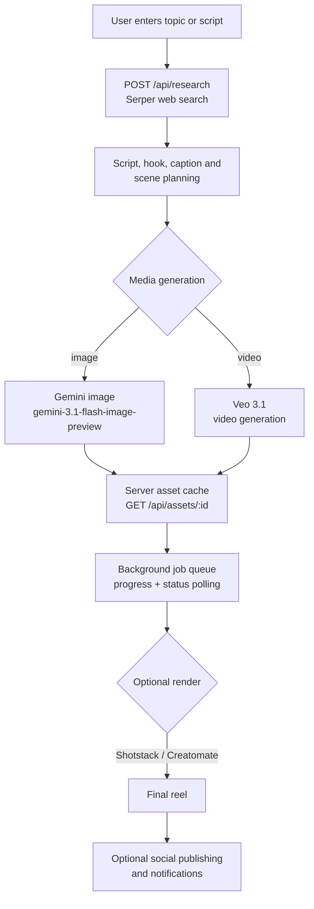

# AI Reel Factory

A full-stack prototype for planning and producing short-form videos from a topic or script. It combines research, scene planning, AI-assisted media generation, asset handling, and optional third-party rendering integrations in one workflow.

## What it includes

- Topic research through an optional search provider
- Script, hook, caption, and scene-planning workflows
- Gemini-powered generation endpoints
- User-uploaded image and video asset handling
- Background job progress and status tracking
- Optional integrations for stock media, text-to-speech, rendering, social publishing, and notifications
- Capacitor configuration for Android packaging

## Tech stack

- React 19 and TypeScript
- Vite 6 and Tailwind CSS 4
- Express and Node.js
- Google Gen AI SDK
- Framer Motion
- Capacitor

## Run locally

Requirements: Node.js 20 or newer and a Gemini API key.

~~~bash
git clone https://github.com/saishivasanjeethpaikarao-jpg/Ai-reels-maker-.git
cd Ai-reels-maker-
npm install
cp .env.example .env
npm run dev
~~~

Add only the provider credentials you need to `.env`. The app starts at `http://localhost:3000`.

## Build and start

~~~bash
npm run build
npm start
~~~

## Environment safety

Never commit real API keys or access tokens. The tracked `.env.example` contains placeholders only; local `.env` files must remain untracked. If a credential was previously committed, remove it from the repository and rotate it at the provider because Git history retains earlier versions.

## Status

This is an active prototype. External generation, rendering, publishing, and notification steps require separate provider accounts and configuration. Review usage limits and costs before enabling them.

## Pipeline

